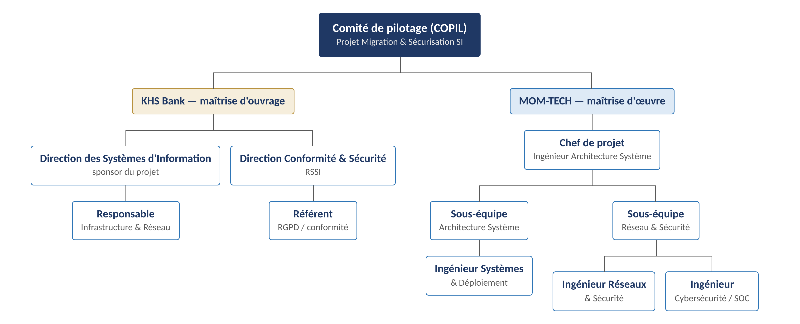

# OBS — Organizational Breakdown Structure

L'OBS identifie qui, côté KHS Bank et côté MOM-TECH, porte la responsabilité de chaque grande famille
de tâches du WBS.

## Répartition des responsabilités par domaine

| Domaine | Porteur principal (KHS Bank) | Porteur principal (MOM-TECH) |
|---|---|---|
| Pilotage global / COPIL | DSI (sponsor) | Chef de projet |
| Conformité réglementaire (RGPD, ACPR, DSP2) | Direction Conformité & Sécurité / RSSI | Ingénieur Cybersécurité |
| Réseau et infrastructure | Responsable Infrastructure & Réseau | Ingénieur Réseaux & Sécurité |
| Systèmes et virtualisation | Responsable Infrastructure & Réseau | Ingénieur Systèmes & Virtualisation |
| Cybersécurité (SOC, PRA/PCA, GED) | RSSI | Ingénieur Cybersécurité / SOC |
| Formation et accompagnement des utilisateurs | Direction des Ressources Humaines | Ingénieur Systèmes & Déploiement |
| Recette et validation | DSI + Direction Conformité & Sécurité | Chef de projet |
