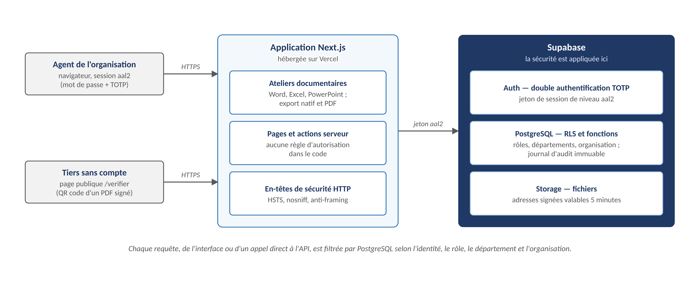
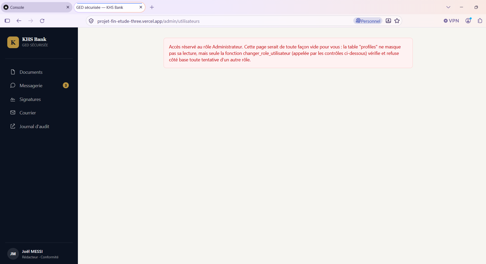

# Lot F (suite) — La GED sécurisée réalisée par MOM-TECH

## 1. Du Lot F à la réalisation

Le Lot F retient une **GED sécurisée dédiée**, réalisée par MOM-TECH avec des outils libres, qui permet de
**créer, valider, signer et archiver** les documents de KHS Bank dans un même outil. Ce chapitre présente
cette réalisation : elle est déployée et utilisable, et les règles de sécurité y sont réellement appliquées
et testées, et non simplement décrites. Le socle Microsoft 365 E5 du [Lot C](lot-c-office365-entra-id.md)
reste en place pour les postes, la messagerie et l'identité, et apporte les compléments du Lot F (Purview
DLP, Entra PIM).

| Exigence du Lot F | Constat d'audit | Mécanisme de la GED |
|---|---|---|
| Classification des documents (public interne / restreint / confidentiel) | C5 | Colonne `classification`, appliquée par la base de données (RLS) |
| Contrôle d'accès par rôle (rédacteur, validateur, administrateur, auditeur) | C5, C8 | Colonne `role` et règles RLS par rôle et par département |
| Authentification forte | C2 | Double authentification TOTP obligatoire (Google Authenticator) |
| Workflow dépôt → vérification → validation → publication | C5 | Fonction transactionnelle `transition_statut_document` |
| Journal d'audit immuable | C5 | Table `audit_log` protégée par un déclencheur PostgreSQL |
| Conservation et archivage réglementés | C17 | Archivage scellé (empreinte SHA-256), lecture seule définitive |
| Authenticité des actes de la Direction | C5 | Signature numérique du Directeur Général, QR code et page publique de vérification |
| Rédaction et édition intégrées | C5 | Ateliers Word, Excel et PowerPoint dans la plateforme, export natif et PDF |
| Traçabilité du courrier physique | C5 | Service du courrier : registres numérotés, numérisation, décharge |

Les fonctions propres à Microsoft 365 (étiquetage automatique par détection de contenu, DLP sur la
messagerie, Entra PIM) sont **apportées par le socle Microsoft 365 E5** et non par la GED : la classification
est posée par l'agent à la création du document et appliquée par la base.

## 2. Les ateliers documentaires : Word, Excel et PowerPoint dans la GED

Les agents **créent leurs documents directement dans la plateforme**, sans logiciel installé sur le poste :

| Atelier | Usage | Contenu |
|---|---|---|
| **Texte** (Word) | Notes de service, comptes rendus, rapports, courriers | Éditeur de texte riche : titres, gras, italique, souligné, alignement, listes |
| **Tableur** (Excel) | Budgets, pièces comptables, suivis | Feuilles de calcul avec formules de calcul |
| **Présentation** (PowerPoint) | Présentations au comité, au conseil d'administration | Diapositives (titre, contenu, puces) |

- **Modèles bilingues** (français / anglais) : note de service, compte rendu, rapport, etc., réservés à
  l'organisation ou communs à toutes ; l'administrateur gère la bibliothèque de modèles.
- **Export** au **format natif** (.docx, .xlsx, .pptx), pour un échange avec l'extérieur, et en **PDF**,
  avec l'en-tête de l'organisation.
- **Chaque document naît classé et tracé** : classification, nature (qui fixe la durée de conservation),
  département, référence unique attribuée par la base (`KHS-2026-000123`), historique dans le journal d'audit.
- **Brouillon privé** : seuls l'auteur et les personnes avec qui il est partagé le voient jusqu'au dépôt.
- **Versions** : une correction d'un document publié ou archivé crée une nouvelle version (v2, v3…).
- **Recherche plein texte** (titre, référence, description, contenu), limitée à ce que l'agent a le droit de
  lire.
- Il est aussi possible de **déposer un fichier existant** : il suit le même circuit
  de validation et de classification.

Le document rédigé dans la GED suit ensuite le circuit de validation, la signature du Directeur Général et
l'archivage décrits plus loin. L'agent n'a donc ni à enregistrer un fichier sur un partage, ni à l'envoyer
par messagerie pour le faire relire.

## 3. Choix techniques

| Couche | Choix | Justification |
|---|---|---|
| Application | **Next.js 16** (React 19, TypeScript) | Framework répandu, rendu côté serveur, un seul code pour l'interface et les actions serveur |
| Données, authentification, fichiers | **Supabase** : PostgreSQL, Supabase Auth, Supabase Storage | Base relationnelle robuste, sécurité au niveau ligne native, authentification multi-facteurs intégrée |
| Hébergement | **Vercel** (version déployée) | Déploiement continu depuis GitHub, HTTPS automatique ; hébergement sur l'infrastructure de KHS Bank possible |
| Mise en forme | Tailwind CSS | Interface cohérente et bilingue (français / anglais) |

Le choix d'outils libres et standards limite le verrouillage fournisseur : la base est une base
PostgreSQL ordinaire, exportable et réinstallable ailleurs. Le rapatriement de l'hébergement vers une
infrastructure maîtrisée par l'organisation est une évolution prévue (voir § 10).

## 4. Architecture applicative

Principe central : **la sécurité est portée par la base de données et non par l'application**. Chaque
requête, qu'elle vienne de l'interface ou d'un accès direct à l'API, est filtrée par PostgreSQL selon
l'identité, le rôle, le département et l'organisation de l'appelant.

## 5. Contrôle d'accès par la base de données (RLS)

*Row Level Security* (RLS) attache à chaque table des règles évaluées par PostgreSQL à chaque lecture ou
écriture. La règle de lecture d'un document, simplifiée, est la suivante :

- le **propriétaire** lit toujours son document ;
- l'**administrateur** et l'**auditeur** lisent tout document sorti du brouillon ;
- un document **publié** est lu selon sa classification : *public interne* par toute l'organisation,
  *restreint* par le département concerné, *confidentiel* par le seul validateur du département
  (en plus du propriétaire, de l'administrateur et de l'auditeur) ;
- un document **en vérification, validé ou rejeté** est lu par le validateur du département ;
- un **brouillon** reste privé : seuls son auteur et les personnes avec qui il est partagé le voient.

Autres dispositions qui renforcent le modèle :

- **Moindre privilège** : tout nouveau compte reçoit le rôle `lecteur`. Seul un administrateur change un
  rôle, par une fonction dédiée ; un utilisateur ne peut pas s'élever lui-même.
- **Droits minimaux (`GRANT`)** : chaque table déclare explicitement ce qui est permis. Aucun `DELETE`
  n'est accordé sur les documents ni sur le journal d'audit.
- **Transitions contrôlées** : le changement de statut passe par une fonction `SECURITY DEFINER` qui
  vérifie le rôle, le département et la cohérence du circuit, puis écrit le journal dans la même
  transaction. Impossible de modifier un statut par une requête directe.
- **Références non falsifiables** : la référence d'un document (`KHS-2026-000123`) est attribuée par la
  base. Une tentative de la fixer ou de la modifier est ignorée.

**Preuve en situation.** La capture ci-dessous a été réalisée sur le site déployé. Un agent connecté avec
le rôle **Rédacteur** (Joël MESSI, département Conformité) a forcé l'adresse de la page d'administration
des utilisateurs. L'accès est refusé. Le refus s'appuie sur trois niveaux de contrôle :

1. **interface** : le menu de l'agent ne propose aucune entrée d'administration ;
2. **page** : un message d'accès réservé au rôle Administrateur remplace le contenu ;
3. **base de données** : la fonction `changer_role_utilisateur` vérifie le rôle de l'appelant et refuse
   toute modification de rôle venant d'un autre profil, même si l'interface était contournée.

{width=70%}

**Test de falsification réalisé :** un rédacteur qui insère un document avec une fausse référence, une
version arbitraire et une date d'archivage obtient un document dont ces valeurs ont été remplacées par
celles de la base ; un agent d'un autre département ou un lecteur reçoit une réponse « introuvable ».

## 6. Double authentification obligatoire

La GED exige un second facteur **TOTP** (code à 6 chiffres renouvelé toutes les 30 secondes, application
Google Authenticator). Elle ne repose pas sur l'interface : sur **toutes les tables**, une règle
RLS *restrictive* (`mfa_obligatoire`) n'autorise l'accès que si le jeton de session porte le niveau
d'assurance `aal2`, c'est-à-dire après validation du code. Sans cela, un agent authentifié par mot de
passe seul ne lit et ne modifie rien, **même en appelant directement l'API de la base**.

Cette mesure répond au constat C2 (absence de MFA) et à l'exigence de chaîne d'authentification forte
pour la messagerie et les données (compétence C16).

## 7. Traçabilité, intégrité et authenticité

- **Journal d'audit immuable.** Chaque action (dépôt, transition, signature, archivage, courrier…) est
  inscrite dans `audit_log`. Un déclencheur `BEFORE UPDATE OR DELETE` refuse toute modification ou
  suppression, **y compris avec la clé de service**. L'auditeur consulte le journal sans pouvoir le
  modifier.
- **Archivage scellé.** Un document publié est archivé par le validateur ou l'administrateur, ou
  automatiquement après *N* mois (12 par défaut). L'empreinte **SHA-256** est calculée et scellée à
  l'archivage ; le document devient en **lecture seule définitive**, même pour l'administrateur. Une
  nouvelle version (v2, v3…) est la seule façon de corriger.
- **Signature du Directeur Général.** Le spécimen de signature et le cachet sont enregistrés une fois et
  protégés. La signature d'un document exige un nouveau code TOTP. Le PDF signé porte un bloc de
  signature et un **QR code** unique. La page publique `/verifier` permet à toute personne (partenaire,
  régulateur) de contrôler l'authenticité en saisissant le code ou en déposant le fichier, sans compte
  et sans divulguer le contenu. Les qualités de signature, les titulaires et les délégations sont gérés
  par l'administrateur, avec un registre complet.
- **Fichiers.** Aucun lien public permanent : chaque téléchargement passe par une **URL signée valable
  5 minutes**. Les pièces jointes de la messagerie passent par une analyse antivirus (type réel du
  fichier, exécutables cachés, macros, JavaScript dans un PDF), complétée en option par un moteur
  externe.
- **En-têtes HTTP de sécurité** : `nosniff`, interdiction d'affichage dans le cadre d'un autre site,
  politique de référent, restriction des API du navigateur et HSTS.

## 8. Service du courrier physique

Le service du courrier étend la GED au courrier papier, très présent dans un établissement bancaire
(mises en demeure, courriers de l'autorité de supervision, pièces de dossiers).

- **Courrier arrivée** : enregistrement sans ouvrir le pli (numéro `ARR-2026-000123`, attribué par la
  base), récépissé PDF, numérisation par scanner ou photos de téléphone assemblées en PDF, remise au
  destinataire avec accusé, imputation au département.
- **Courrier départ** : demande d'expédition depuis un document validé (la lettre signée est jointe),
  numéro `DEP-…`, bordereau d'envoi, relances, et accusé de réception prouvé par une **décharge**
  (fichier, date réelle de remise, signataire) ; l'exception sans décharge est réservée au chef du
  courrier et doit être motivée (10 caractères au moins).
- **Conservation** : catégories et durées de conservation (propositions à valider par la conformité),
  gel de conservation, propositions de destruction validées par le chef du courrier. **Aucune
  destruction automatique.**
- **Protection des plis personnels** : un pli signalé comme personnel n'est ni décrit ni numérisé.
- Le chef du courrier est désigné par un administrateur ; personne ne peut s'attribuer ce rôle.

## 9. Une plateforme, plusieurs organisations

Le même code et la même base servent plusieurs organisations (KHS Bank pour la soutenance, l'Agence de
Promotion des Investissements du Cameroun pour un second cas d'usage réel). Le cloisonnement est
**garanti par la base** : chaque ligne porte une colonne `organisation`, posée par un déclencheur à
partir du profil de l'appelant et jamais par le navigateur ; les règles RLS comparent systématiquement
cette valeur. Un agent d'une organisation ne voit donc jamais les données d'une autre.

Le branding (nom, logo, couleurs, modules activés) est piloté par des variables d'environnement
`NEXT_PUBLIC_ORG_*` : redéployer pour une nouvelle organisation ne demande aucune modification du code.
Les catégories de conservation du courrier sont paramétrées par organisation.

## 10. Validation, limites et évolutions

**Vérifications réalisées :**
- rejeu intégral des 33 migrations sur une base vierge, sans erreur ;
- tests SQL de la sécurité : 169 tests sur le courrier de l'Agence et 15 sur celui de KHS Bank, auxquels
  s'ajoutent les tests du circuit documentaire, de la visibilité, de la signature et de l'archivage ;
- parcours de bout en bout dans un navigateur automatisé (42 contrôles sur le courrier) ;
- compilation de production (`next build`) et typage TypeScript sans erreur ;
- mise à niveau de sécurité du framework (Next.js 16.4.5) après audit des dépendances.

**Limites assumées :**
- pas de filtrage DLP ni d'étiquettes de sensibilité automatiques dans la GED elle-même : le DLP sur les
  flux sortants est assuré par Microsoft Purview (messagerie, Teams, OneDrive) ; dans la GED, la
  classification est posée par l'agent et appliquée par la base ;
- les ateliers couvrent la rédaction courante (texte, tableur, présentation) ; la mise en page très
  élaborée reste du ressort des logiciels bureautiques, avec export et import au format natif ;
- antivirus ciblé : les contrôles intégrés complètent un moteur externe sans remplacer une solution
  d'entreprise ;
- une adresse e-mail correspond à un compte, l'authentification étant partagée entre organisations ;
- hébergement actuel sur des services cloud : le rapatriement vers une infrastructure maîtrisée par
  l'organisation fait l'objet de propositions d'architecture distinctes.

**Évolutions :** intégration à l'annuaire de l'établissement (Entra ID) pour l'authentification unique,
étiquetage automatique par détection de contenu, hébergement souverain, supervision des échecs d'authentification
dans le SIEM.

## 11. Compétences du référentiel mobilisées

| Compétence | Apport de la GED |
|---|---|
| C11 — Recenser les points de vulnérabilité | Audit de dépendances, correctifs de sécurité du framework, tests de falsification |
| C12 — Scénarios d'attaque | Tentatives de contournement testées : falsification de références, accès direct à l'API sans second facteur, modification du journal, lecture inter-départements et inter-organisations |
| C16 — Authentification et protection des comptes | MFA TOTP obligatoire appliquée par la base |
| C17 — Protection des données au repos et en transit, archivage | HTTPS, URL signées, empreintes SHA-256, archivage en lecture seule, durées de conservation |
| C18 — Besoins de protection des données | Classification en trois niveaux, cloisonnement par département et par organisation |
